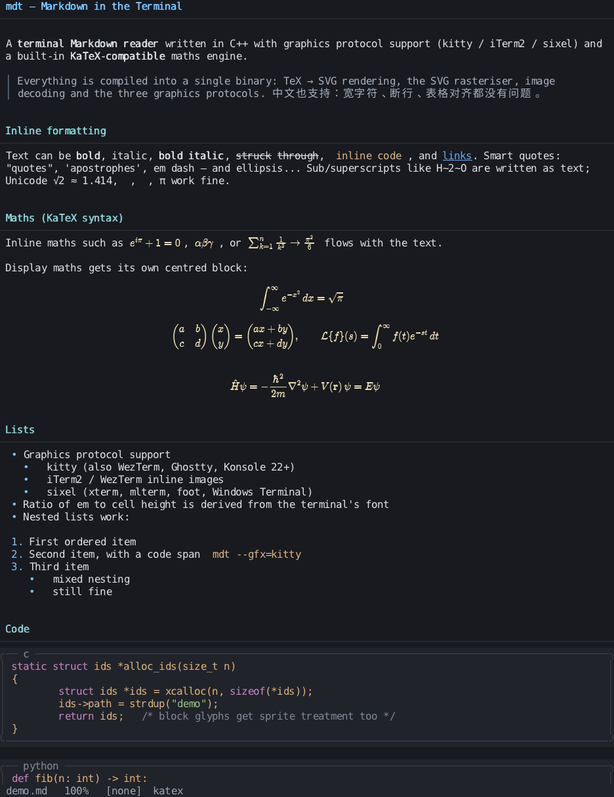

# mdt — Markdown in the terminal

[](https://github.com/wudream813/markdown-in-terminal/actions/workflows/build.yml)
[](https://github.com/wudream813/markdown-in-terminal/releases/latest)
[](LICENSE)

**English** · [中文说明](README.zh-CN.md)

A **C++17 terminal Markdown reader** that draws maths and images through the
terminal *graphics protocol* (kitty / iTerm2 / sixel), with a **built-in
KaTeX-compatible maths engine**. Everything — the TeX typesetter, the SVG
rasteriser, image decoding, the three graphics protocols — lives inside a single
self-contained binary.



```
  ┌─ demo.md ───────────────────────────────────────────────────────────────┐
  │  ∫_{-∞}^{∞} e^{-x²} dx = √π          # typeset by the embedded engine   │
  └─────────────────────────────────────────────────────────────────────────┘
```

More screenshots: [a Luogu 题解 with callouts and images](docs/luogu-render.png) ·
[tables with merged cells](docs/table-render.png) ·
[`pmatrix` display maths](docs/matrix-render.png) ·
[nested blockquotes](docs/nested-quotes.png) ·
[syntax-highlighted code](docs/code-render.png) ·
[the same reader on Windows](demo/windows.png).

## Highlights

* **KaTeX syntax, no runtime dependencies.** The maths pipeline is
  TeX/KaTeX source → SVG (MathJax's TeX input jax + SVG output jax, ~1.8 MB of JS
  embedded in the binary) → rasterised by a small hand-written SVG renderer →
  PNG. The JS is executed by an embedded **QuickJS** interpreter, so a single
  `mdt` executable renders `\frac`, `\sum`, `\int`, `\begin{pmatrix}` … with no
  node, no browser and no external files.
* **Three graphics protocols**, auto-detected at start-up:
  kitty (`\x1b_G…`, also WezTerm/Ghostty/Konsole), iTerm2 inline images
  (`\x1b]1337;File=`), and sixel (xterm/mlterm/foot/Windows Terminal) with a
  median-cut 256-colour encoder.
* **Inline graphics.** Formulas and images sit on the text baseline
  (fractional cell offsets on kitty, cell-aligned elsewhere) and flow with the
  paragraph.
* **Graceful degradation.** In a terminal without a graphics protocol the
  formulas are transcribed to Unicode (`∑`, `∫`, `√`, sub/superscripts) instead
  of disappearing. `m` toggles between typeset and plain maths live.
* **Runs on Windows too.** The same source builds a self-contained `mdt.exe`
  with MinGW-w64 (one `make windows`); see the cross compilation section below.
* **Mouse and scrollbar.** The wheel scrolls (SGR *and* X10 mouse reports,
  so it also works in terminals without SGR mouse mode), clicking the
  scrollbar in the right margin jumps through the document and dragging it
  tracks live (button-event motion reporting, mode 1002: every motion event
  between press and release moves the view, not only the release), and
  clicking links/headings/outline entries works as before, dialog buttons and
  folding-box titles and outline entries light up while the pointer is on
  them, and clicking a folding-box title folds or unfolds the box.
* **Luogu (洛谷) dialect.** On top of GFM, mdt understands the
  remark-directive syntax of the Luogu article editor: `:::info`,
  `:::success`, `:::warning` and `:::error` callouts (coloured bar, bold
  title from `[...]`, nesting via longer colon fences), `:::align{left|
  center|right}`, Codeforces-style `:::epigraph[——author]`, the
  `::cute-table{three}` / `::cute-table{tuack[=N]}` table styles, `^`/`<`/`>`
  table cell merging, ```` ```cpp lines=5-6,11 ```` code line highlights, and
  the Luogu convention that a fence without a language tag means C++
  (`plain`/`plaintext` turns highlighting off), line-number gutters in code
  blocks of Luogu documents, formulas inside callout titles
  (`:::info[$x^2$ …]`), per-level coloured bars for nested callouts, and a
  readable (non-dimmed) `:::epigraph`. Documents that use no directives keep
  their previous behaviour.
* **Forgiving with generated Markdown.** Files that came out of a generator
  instead of somebody's hands are recognised and repaired before parsing:
  * *HTML-escaped sources* ("copy as markdown", CMS exports): every Markdown
    character arrives as a character reference - `&#35;` for `#`, `&#x09;`
    for a tab. The repair is **opt-in** (`--entities=force`): mdt used to guess
    from the shape of the text, and because the escaping belongs to how a file
    was pasted rather than to the file itself, a wrong guess rewrote maths and
    code silently. Character references in ordinary prose are still decoded the
    way CommonMark asks for (`&amp;` -> `&`).
  * *Backslash-escaped sources*: every syntax character is escaped - `\#`,
    `\-`, `\*`, `1\.`. Detected and unescaped (double escapes such as `\\#`
    too), so headings, lists, tables and emphasis come back.
    `--escapes=off|force` controls it. The repair never looks inside maths or
    code: backslashes are syntax there (a matrix row separator is `\\`, a code
    block is literal text), so a document full of `pmatrix` rows used to be
    mistaken for an escaped source and lost one backslash per row - every
    matrix collapsed into a single row. `\\` is no longer counted as an escape
    either.
  * *HTML inside a `.md` file*: `<p>`, `<h2>`, `<ul><li>`, `<table>`, `<pre>`
    and inline tags are converted to the Markdown they stand for, including
    `<strong>`/`<em>`/`<code>`/`<a href>`/``; prose placeholders such as
    `<that>`, `<T>` or `a < b` are left alone.
  * *CJK markers without the CommonMark space*: `#标题`, `-项目`, `1.项目`,
    `>引用`. Accepted for a document that is written that way throughout and
    that contains no space-separated marker at all (`--loose=off|on` overrides).
  The status bar shows which repairs were applied (`+entities`, `+escapes`,
  `+loose`).
* **Blockquotes nest.** `>`, `> >`, `> > >` … each level gets its own bar and
  two more columns of indent, and a nested block of any kind (paragraph, code,
  list, table, another quote) lives inside the quote. Wrapped lines keep every
  bar, and two paragraphs separated by a `>` blank line stay in one quote while
  a bare blank line starts a new one (CommonMark).
* **Non-ASCII file names work on Windows.** Windows hands `main()` its
  arguments in the ANSI code page, not UTF-8, so `mdt 中文.md` used to fail with
  a mangled path (and a UTF-8 path never reached the file API, which wants
  UTF-16). The command line is now rebuilt from `GetCommandLineW()`, every path
  is opened through `_wfopen`/`GetFileAttributesW`, and the console code page is
  switched to UTF-8 before anything is printed - so file names in the status
  bar, in `--diag` and in error messages come out right too. On the POSIX side
  nothing changes: paths were always bytes and still are.
* **Blocks nested in list items** keep their shape: quotes keep their bar,
  tables are drawn as a frame indented under the bullet, and any other block
  falls back to its text instead of disappearing.
* **Compact frame output.** Only changed cells are sent, with one cursor jump
  per run and one SGR per style change (a heading costs one escape sequence,
  not one per character). Nothing needs re-drawing that has not changed.
* **Formulas in tables are typeset too.** A table cell is a text grid, so the
  cell keeps a Unicode transcription (`x² + y² = z²`, `\frac{a}{b}` -> `a/b`)
  as the layout and as the fallback for terminals without graphics. Where a
  graphics protocol is available a bitmap - exactly as wide as that
  transcription, one cell tall, with the page colour behind the ink - is drawn
  over the transcription, so the cell shows the typeset formula.
* **Formulas stay sharp.** A formula is rasterised onto the exact cell grid
  (`cols × cell_w` by `rows × cell_h` pixels) and placed so the terminal draws
  it 1:1 instead of rescaling it; the baseline of the bitmap is put on the
  baseline of the text line. When the terminal does not report its cell size,
  the image is placed at its own pixel size rather than squeezed into one cell.
* **Headings carry a dimmed `#`.** `#`, `##`, ... are drawn in the muted colour
  in front of the heading text, so a heading is recognisable without relying on
  its colour alone. Wrapped heading lines stay aligned with the text.
* **Lists and code blocks that read well.** Task items use `[x]` / `[ ]`
  (the ☑/☐ glyphs have ambiguous width, so the tick and the box did not line up
  in every font). A code block's frame spans the page (as it always did; use
  `--code-fit` for a frame that hugs the code) and long code lines wrap instead
  of being cut off at the frame edge.
* **Graphics inside table cells.** A formula in a table cell is typeset as a
  bitmap that is as wide as the cell's Unicode transcription and exactly one
  cell tall. Its baseline is baked into the bitmap (the formula is shifted and,
  if need be, scaled so that its baseline lands on the cell's text baseline),
  which means the bitmap is placed exactly on the cell's row - no sub-cell
  offset, so it cannot hang over the row above or below. The page colour is
  painted behind the ink *and* the transcription is removed from the text layer
  while the bitmap is up (terminals draw cell text above placed images, which is
  how the transcription used to peek out from under a formula). Without a
  graphics protocol the transcription stays and is all you see.
* **Images sit on the nearest cell row.** Formula and picture bitmaps are
  anchored to the cell row the text baseline falls into (rounded, not floored).
  Rounding down put a formula whose baseline was a fraction of a pixel above the
  text baseline one row too high - in a table it looked shifted, and on the
  first line of a document it was treated as scrolled off the top and replaced
  by a placeholder box. Visibility is now decided in pixels, so a bitmap whose
  anchor row is the row above the viewport is clamped, not dropped.
* **A blank line after every code line is a paste artifact.** Some generators
  emit a blank line between each pair of lines of a code block. If a block is
  double spaced like that throughout it is reflowed tightly (the file is not
  changed, only the drawing); a block with a few deliberate blank lines, or with
  a real empty region, is left exactly as written.
* **Pictures from the network never block the reader.** A ``
  is downloaded on a worker thread: the first frame is on screen in a fraction
  of a second with a `[loading…]` placeholder, scrolling and every key keep
  working, and the layout is refreshed the moment the bytes arrive (the status
  bar says `loading images…` meanwhile). Before this, the event loop sat in the
  download - a 题解 with three pictures on a slow CDN took 17 s to show anything
  and answered keys ~3 s late, which read exactly like "scrolling, `?` and Esc
  are broken". `R` forgets the downloads so a picture can be fetched again; a
  terminal without a graphics protocol never touches the network at all.
* **Escaped line endings are not doubled.** A generator that escapes line
  breaks writes `&#10;` and then a real newline; decoding that used to put an
  empty line between every two lines - very visible inside a code block. The
  reference is now recognised as the line ending it stands for.
* **Nothing is drawn over the UI.** While the help panel is open no image is
  transmitted or placed, images that would spill into the status bar are
  skipped, and the outline panel covers no images - so a formula can no longer
  sit on top of the panel in a terminal that cannot erase bitmaps cell by cell.
* **Leaves the terminal usable.** Normal exit, `kill`, Ctrl-C/Ctrl-Break and a
  closed console window all hand the terminal back: alt screen off, mouse
  reporting off, cursor shown, tty modes (termios / `SetConsoleMode`) restored.
* Terminal abilities are probed at run time: cell size in pixels (`CSI 16 t`),
  window size (`CSI 14 t`), sixel support (DA1), kitty graphics support
  (`\x1b_Gi=…,a=q`). The em/cell ratio follows the user's real font.

## Install

Prebuilt binaries are on the [releases page](https://github.com/wudream813/markdown-in-terminal/releases/latest) —
one file, nothing to install besides it.

| platform | file | notes |
|:--|:--|:--|
| Linux x86-64 | `mdt-linux-amd64` | needs glibc ≥ 2.38 (Ubuntu 24.04+, Debian 13+, Fedora 39+); on older distributions build from source |
| macOS arm64 | `mdt-macos-arm64` | Apple silicon; the binary is not signed/notarised, so `xattr -d com.apple.quarantine mdt` once after downloading |
| Windows x64 | `mdt-win64.exe` | or `mdt-0.3.8-win64.zip`, which also carries the demo |

```sh
# Linux — read your first file
curl -fL -o mdt https://github.com/wudream813/markdown-in-terminal/releases/latest/download/mdt-linux-amd64
chmod +x mdt && sudo install -m 0755 mdt /usr/local/bin/mdt
mdt --list-caps          # what mdt detected: cell size, graphics protocol, fonts
mdt README.md

# macOS (Apple silicon)
curl -fL -o mdt https://github.com/wudream813/markdown-in-terminal/releases/latest/download/mdt-macos-arm64
chmod +x mdt && xattr -d com.apple.quarantine mdt 2>/dev/null
sudo install -m 0755 mdt /usr/local/bin/mdt
```

Nothing is written to your home directory: no config file, no cache.  `mdt` does not
touch the network unless a document actually contains a `` picture.

## Build

```sh
make -j            # produces build/mdt  (needs a C11 + C++17 compiler)
# or
cmake -B build && cmake --build build -j
```

Linux and macOS both build from the same sources (the POSIX branch of
`src/platform.cpp`; on macOS the reader looks for Menlo/Monaco in
`/System/Library/Fonts` and PingFang in `/System/Library/Fonts/Supplemental`).
There is nothing to install beyond a compiler and `make`.

Everything else is vendored: `stb_truetype/stb_image/stb_image_write/stb_image_resize2`
and QuickJS-NG. `python3` is only needed when you change the JS bundle
(`make assets`). If libcurl is available it is linked in for remote images;
otherwise the `curl` binary is used as a fallback.

## Building for Windows (MinGW-w64 cross compilation)

Linux and Windows share the whole program; the only OS-specific code is
`src/platform.{h,cpp}`, which switches between POSIX (termios/ioctl/SIGWINCH)
and the Win32 console API (`SetConsoleMode`, `ENABLE_VIRTUAL_TERMINAL_*`,
UTF-8 code pages, `ReadFile`/`WriteFile`, console font probing for the font
search). Nothing has to be configured — the compiler flags pick the branch.

```sh
sudo apt install mingw-w64          # or: dnf install mingw64-gcc-c++; brew install mingw-w64

make windows                        # -> build/win/mdt.exe         (x86-64)
make windows32                      # -> build/win32/mdt.exe       (32 bit)
sh tools/build_windows.sh           # build + dependency check + dist/*.zip
```

With CMake instead:

```sh
cmake -B build/cmake-win -DCMAKE_TOOLCHAIN_FILE=cmake/mingw-w64-toolchain.cmake
cmake --build build/cmake-win -j
```

Notes:

* The `.exe` is linked with `-static -static-libgcc -static-libstdc++`, so it
  depends only on `KERNEL32.dll` and `msvcrt.dll` — no MinGW runtime DLLs to
  ship, one file to copy.
* QuickJS (the embedded TeX engine) is cross compiled with
  `-funsigned-char -D_GNU_SOURCE -DCONFIG_VERSION='"2025-09-13"'` and links
  against `-lws2_32`.
* libcurl is not used in the Windows build (a host libcurl cannot be linked
  into a PE binary); remote pictures go through **WinINet** instead, which is
  part of Windows - no curl.exe on the PATH is needed.
* Fonts come from `%WINDIR%\Fonts` (Consolas/Cascadia Mono for text, MS YaHei /
  SimSun / Noto CJK for wide characters), discovered at runtime.

### Verifying the Windows build

On Windows: `mdt.exe --list-caps`, `mdt.exe demo\demo.md`.

On Linux, with Wine and a pty driver:

```sh
export WINEPREFIX=~/.wineprefix        # created on first run
wine64 build/win/mdt.exe --version
sh tests/windows.sh          # text output, maths, PNG export, themes, console mode
```

`tests/windows.sh` diffs `--dump` against the native build byte for byte
(Wine's console adds CRs, which the test strips), renders maths through the
embedded QuickJS+MathJax engine, checks all four themes and drives the console
inside a pty (`tools/wine_pty_test.py`): alt screen, mouse reporting,
capability probing and the status line. `tools/panic_test.py` then interrupts
the running program and asserts that it hands the terminal back (same script
on both platforms, exit code 143 for SIGTERM / 130 for Ctrl-Break).
A GitHub Actions workflow (`.github/workflows/build.yml`) runs the Linux build,
the Windows cross build and both test batteries.

Checked in this repository: `x86_64-w64-mingw32` 14.2.0 + wine 10.0 —
`--dump` output identical to the Linux build (121 lines), `--screenshot` PNG
valid, four themes OK, pty console checks pass, imported DLLs
`KERNEL32.dll`/`msvcrt.dll` only. The 32 bit build compiles and links the same
way but was not run here (Debian's `wine64` package has no 32 bit support).

## Usage

```sh
mdt README.md                 # read a file
mdt --toc notes.md            # start with the outline panel open
mdt --gfx=kitty --theme=light big.md
mdt --dump --width=100 x.md   # text rendering to stdout (no graphics)
mdt --screenshot=shot.png x.md  # render the whole screen to a PNG
cat notes.md | mdt --dump -   # read the document from stdin
```

Options

| flag | meaning |
|:--|:--|
| `--gfx=auto\|kitty\|iterm2\|sixel\|none` | graphics protocol (default `auto`) |
| `--math=katex\|unicode\|off` | maths engine (default `katex`, built in) |
| `--theme=dark\|light\|nord\|monochrome` | colour theme |
| `--toc` | open the outline panel on start |
| `--line-numbers` | line numbers in code blocks |
| `--no-syntax` | disable code highlighting |
| `--font-px=N` | override the derived maths font size |
| `--dump[=file]`, `--screenshot=out.png`, `--width`, `--height` | non-interactive output |
| `--list-caps` | print the detected terminal capabilities |

Keys

| key | action |
|:--|:--|
| `j` `k` `↓` `↑` | scroll a line |
| `space` `b` / `d` `u` | page / half page |
| `g` `G` | top / bottom |
| `J` `K` | next / previous heading |
| `Tab` | outline panel (Enter or click jumps to a heading) |
| `/` `n` `N` | search, next / previous match |
| `t` | cycle theme (`dark`, `light`, `nord`, `monochrome`) |
| `m` | toggle typeset ⇄ plain-Unicode maths |
| `r` | reload the file |
| `o` | open the first link in the browser |
| `e` | export the document text to the clipboard (OSC 52); quotes, lists, tables and callout content are kept in full |
| `?` | help · `q` / `Ctrl-C` quit |

## How the maths pipeline works

```
$…$ / $$…$$ in markdown
        │
        ▼
Mathjax TeX→SVG (JS, embedded)         ← KaTeX-compatible syntax, TeX superset
   run by QuickJS inside the binary
        │  <svg viewBox="0 -1562.5 8064.8 2808.5" width="18.2ex">
        ▼
svg.cpp: XML + path (M/C/S/Q/A/Z, transforms, matrices, nested <svg>
   viewports - MathJax draws an extensible bracket as three stacked pieces in
   an inner <svg>, which used to be skipped entirely, leaving matrices with a
   single bracket) parser
   → flattened into polygons, scan-line rasteriser with non-zero winding,
     supersampled anti-aliasing, composited to RGBA
        ▼
render.cpp: sized against the terminal's cell grid, laid out on the text
   baseline (em = 0.85 · cell height, baseline = 0.76 · cell height)
        ▼
term.cpp: PNG for kitty/iTerm2, sixel for sixel terminals,
          cached by content hash so each image is transmitted only once
```

Metrics come out of the SVG (`viewBox` and `vertical-align:-2.819ex`), which is
exactly what a browser would use, so inline formulas align with the surrounding
text instead of floating.

## Layout

```
src/util.*        UTF-8 + wcwidth tables, strings, base64, colours
src/platform.*    the only OS-facing code: POSIX tty/window/IO  +  Win32 console
src/term.*        capabilities, cell framebuffer with diffing, kitty/iTerm2/sixel
src/md.*          CommonMark subset + GFM tables/strike/task lists + $maths$
src/svg.*         SVG subset parser + software rasteriser
src/math.*        QuickJS host + maths metrics/raster cache + Unicode fallback
src/image.*       stb_image decode, scaling, PNG encode, http(s) fetch
src/render*.cpp   document layout and drawing (text grid + graphics overlays)
src/font.*        TrueType rasteriser used by --screenshot
src/app.cpp       event loop, outline, search, status bar
src/generated/    the embedded JS bundle (generated by tools/build_assets.py)
vendor/           stb single-file libraries, QuickJS-NG
```

`tools/pty_test.py` drives the binary in a pty and checks that each protocol
really emits its escape sequences. `sh tests/smoke.sh` builds nothing but runs
the whole battery (themes, maths modes, stdin, text export, all three
protocols) against `./build/mdt`. For the Windows build, `sh tests/windows.sh`
does the same through Wine (including the console path, via
`tools/wine_pty_test.py`) and compares the rendered text with the native
binary. `tools/async_image_test.py` opens a document whose pictures sit on a slow host
and checks that the first frame is up in well under a second, that the keys
answer while the downloads run, that each picture is fetched exactly once and
that it does get drawn in the end. `tools/subcell_align_test.py` guards the
vertical alignment of inline formulas and pictures: the sub-cell offset is
baked into the bitmap, so a terminal that cannot place an image at a pixel
offset inside a cell (iTerm2, sixel) draws it on exactly the same rows as one
that can; the test renders the same document twice - `MDT_SNAP_SUBCELL=1`
makes `--screenshot` composite the "no sub-cell offset" way - and requires the
two pictures to be identical. `tools/tall_math_test.py` guards the other half
of the same story: a multi-line formula (`$\begin{aligned}...$`, inline
delimiters) spans several terminal rows, so the line that carries it reserves
them (`Line::rows`); the test checks in the screenshot that no pixel row mixes
formula ink with prose ink and that the prose after the block starts below it.
`tools/build_windows.sh` makes the release zip.

## Performance notes

Measured on a 250 KB document (400 sections, ~420 formulas, tables, code, images):

| stage | time |
|:--|--:|
| markdown parse | 6 ms |
| layout of the whole document, formulas deferred | 21 ms |
| first frame on screen (incl. QuickJS start-up ~150 ms) | 0.57 s |
| same document with eager formula typesetting (old behaviour) | 2.5 s |
| re-render of a scrolled frame | < 10 ms, formula bitmaps are cached |

Formulas are typeset lazily: only the ones that come into view are measured and
rasterised. If a deferred formula turns out to be bigger or smaller than the
layout estimate, the document is relaid out once (metrics are cached by then) so
the final geometry is exact.

## Display options

| Flag | Effect |
|---|---|
| `--panels` | tinted backgrounds behind code blocks, quotes and table headers (off by default: the page uses one background colour) |
| `--terminal-bg` | emit SGR 49 for the page background, so the terminal's own colour/transparency shows through |
| `--no-scrollbar` | hide the scrollbar |
| `--encoding=auto\|utf-8\|gbk\|gb18030\|big5\|cp1252\|latin1\|off` | how to read a file that is not UTF-8 (default `auto`: GBK/GB18030, the "ANSI" code page of a Chinese Windows) |
| `--entities=off\|force` | repair a source that was HTML-escaped before it reached you (off by default) |
| `--escapes=auto\|off\|force` | control the backslash-escape repair described above |
| `--loose=auto\|off\|on` | accept `#标题` / `-项目` / `1.项目` without a space |
| `--code-fit` | code frames hug the code instead of spanning the page |
| `--cell=WxH` | cell size in pixels for `--dump`/`--screenshot` (default 9x19), so a screenshot can match your terminal exactly |
| `--compat` | no graphics, no DEC 2026 synchronized output, no keyboard-protocol push, no capability probe - for terminals whose support for those is broken |
| `--diag` | print what mdt sees of the file (encoding, escapes, block census, first characters) and of the terminal; works without a tty |

### Settings file

Typing the same flags every time gets old, so mdt reads one file of defaults:

```
~/.config/mdt/config            # Linux/macOS ($XDG_CONFIG_HOME/mdt/config)
%APPDATA%\mdt\config           # Windows
```

```ini
# mdt settings — the command line always wins over this file
theme = nord
panels = 1
scrollbar = off
line_numbers = on
```

Keys: `theme`, `gfx`, `math`, `panels`, `terminal_bg`, `scrollbar`,
`line_numbers`, `syntax`, `code_fit` (true values: `1 on yes true`).  An unknown
key or value is reported on stderr instead of being ignored, and `--diag` prints
which file was read.  `MDT_CONFIG=/path/to/file` points at another file.

`NO_COLOR=1` (see [no-color.org](https://no-color.org)) switches to the
monochrome theme, unless a theme was asked for explicitly.

### Markdown notes

GitHub alerts (`> [!NOTE]`, `[!TIP]`, `[!IMPORTANT]`, `[!WARNING]`,
`[!CAUTION]`) render as a quote with a bold label, `<details>`/`<summary>`
collapses into a label line plus its body instead of gluing the two together,
and a heading like `# Title {#custom-id}` drops the attribute list.  YAML front
matter at the top of a file is skipped, and reference links
(`[text][ref]`, `[text][]`, `[ref]`) are resolved from their
`[ref]: https://…` definitions — a label that is not defined stays literal
text, the way CommonMark asks.

Footnotes (`[^1]` / `[^1]: the note`) are numbered where they are first *used*
and the notes are printed as an ordered list at the end of the document, and
`Term` + `: definition` lines render as a definition list rather than one long
paragraph.  `mdt --diag file.md` reports how many of each it found.

## Big documents

A 4 MB Markdown file used to need 500 MB of RAM: the reader kept the parse tree,
one `Line` per screen row for the whole document, and a screen as tall as the
document (`Screen` keeps two cell buffers, so that alone was 190 MB).  `--dump`
now lays the document out in slices and prints each one as it goes, which is
where most of it went.  `mdt --diag file.md` prints what a document costs:

```
  block struct    : 568 bytes (span 120, line 256, run 168, table cell 96)
  layout          : 80110 rows, 65110 lines, 57212 runs, 0 table cells
  memory          : 83.5 MB peak RSS for the whole document
```

`make mem-report && ./build/mem-report big.md` prints the same numbers with the
breakdown per phase (parse, layout, run text) for whoever is working on it, and
`tests/smoke.sh` fails if a 3 MB document goes over its budget.

## The command line is checked

An option that makes no sense is reported instead of quietly ignored: a
misspelled value (`--theme=drak`) exits 2 and prints the values that would have
worked, sizes have to be sane (`--width` 0 means "derive it", anything from 1
to 4096 is accepted, `--width=1000000` used to ask for a million-column
framebuffer and die), `--cell` needs a real `WxH` in pixels, and pointing mdt at
a directory says "`X` is a directory, not a file" rather than rendering nothing
and exiting 0.  Two files on the command line are refused instead of silently
dropping the second one, and `mdt --dump big.md | head` exits 0 instead of being
killed by SIGPIPE.  `sh tests/cli.sh` covers all of it (and runs inside
`tests/smoke.sh`).

## When something looks wrong

Three switches exist for the cases where the terminal and mdt disagree:

| Tool | What it answers |
|---|---|
| `mdt --diag file.md` | what mdt sees of the file: encoding (BOM? UTF-8? GBK?), line endings, which repairs were applied, the block census, the first characters as code points - and what it sees of the terminal. Works without a tty, so the output can be pasted into a bug report. |
| `MDT_FRAME_LOG=/tmp/mdt.log mdt file.md` | writes every frame exactly as it was sent, escape sequences spelled out. Compare it with what the screen shows to tell "mdt drew it wrong" apart from "the terminal lost it". |
| `mdt --compat file.md` | turns everything optional off - graphics, DEC 2026 synchronized output, the kitty keyboard push, the capability probe - and paints each changed row from column 0 as one run, so no cursor jump ever happens inside a row. If the display becomes correct, the terminal is mishandling one of those; `--compat` is the workaround. |

The repairs on the source side can be controlled individually with
`--entities`, `--escapes`, `--loose`, `--encoding` and the status bar shows
which of them were used (`+entities`, `+escapes`, `+loose`, `+clean`,
`+gb18030`).

### A file that is not UTF-8

A Markdown file saved by a Chinese Windows editor is usually GBK (the "ANSI"
code page), and every Chinese character in it used to be printed as mojibake.
mdt now notices that the bytes are not valid UTF-8 and converts the text before
parsing - the heading, the lists and the code blocks all survive, and `--diag`
says what it did:

```
  encoding        : utf-8, no BOM, but 23 invalid byte(s) before offset 200000 - probably not UTF-8 (GBK/ANSI?)
                    -> converted from gb18030 to UTF-8 for rendering
```

`--encoding=` overrides the guess: `gbk`, `gb18030`, `big5`, `cp1252`, `latin1`
or `off` (leave the bytes alone).  Automatic detection assumes GBK, because
GB18030's byte space is a superset of Big5's - a Big5 document converts
"successfully" into wrong characters, so pass `--encoding=big5` for those.

## Notes / limitations

* Block-level maths is centred and drawn as a bitmap; very wide equations are
  scaled down to the content width.
* sixel images are cell-aligned (a sixel cursor cannot be nudged by a fraction
  of a cell), kitty and iTerm2 images are placed by pixel and land on the text
  baseline. Inline maths inside a table cell is typeset as a bitmap on top of its
  Unicode transcription; without a graphics protocol the transcription is what
  shows.
* Reference-style links `[text][ref]` are parsed but the definitions are not
  resolved yet; `_italic_`/`**bold**` inside words follow the CommonMark rules.
* Nothing a document contains is ever given to a shell.  A picture URL
  (``, fetched with the `curl` binary when no libcurl is linked
  in) and a link opened with `o` reach `execvp()` / `CreateProcess()` /
  `ShellExecuteW()` as single arguments, so a `"`, `;`, `$` or backtick in a
  URL stays part of that URL.  (Until 0.3.7 both places built a command line
  and ran it with `popen()`/`system()`: `` ran
  `cmd` just by opening the file - see `tools/injection_test.py`, which guards
  this.)  A link is also only passed on when its scheme is one of `http`,
  `https`, `mailto`, `ftp`, `ftps`, `file`, `tel`; a markdown link to a local
  path is refused instead of being handed to the OS launcher, which would have
  opened (or on Windows, executed) whatever it pointed at.
* HTML blocks are converted to the Markdown they stand for; unknown tags are
  dropped while their text is kept.
* On Windows the reader needs a VT-capable terminal (Windows Terminal, Windows
  10 1703+ conhost); it turns VT processing on itself, so `cmd.exe` works too.
  Kitty/iTerm2 protocols are a POSIX-terminal thing — on Windows you get sixel
  (Windows Terminal 1.22+, WezTerm, mintty) or the Unicode maths fallback.
* Luogu callouts are folding boxes: collapsed by default, `{open}` on the
  directive starts them expanded, and clicking the title band toggles them
  live (the title carries a `▸`/`▾` state arrow and a hover wash).  Jumps that
  land inside a folded box (search, outline, `J`/`K`) open it on the way, and
  the outline and search see text inside the boxes too.  Plain-text
  dumps always print the full content of every box.  Bilibili video embeds are
  not played — the reader is
  text and pictures only. `^`/`<`/`>` merge markers and the C++ default for
  bare fences only apply to documents that use directive syntax, so ordinary
  Markdown keeps its usual meaning.
* Mouse input is parsed from both SGR (`\x1b[<b;x;yM`) and X10 (`\x1b[M`) reports;
  the wheel scrolls three lines per notch, the scrollbar jumps proportionally.
* Resizes: POSIX uses SIGWINCH, Windows polls `GetConsoleScreenBufferInfo`
  (conhost and Windows Terminal update it on resize). Wine's console reports a
  fixed size and never follows pty resizes, so `tools/resize_test.py` skips the
  resize steps there (`MDT_RESIZE_SKIP=1`) and CI only checks the geometry.

MIT licensed — see [LICENSE](LICENSE).  The binary embeds other people's work
(QuickJS-NG — MIT, MathJax — Apache-2.0, the KaTeX fonts — SIL OFL 1.1, stb —
MIT/public domain); [THIRD_PARTY_NOTICES.md](THIRD_PARTY_NOTICES.md) spells out
what is inside and [licenses/](licenses/) carries the full texts.
